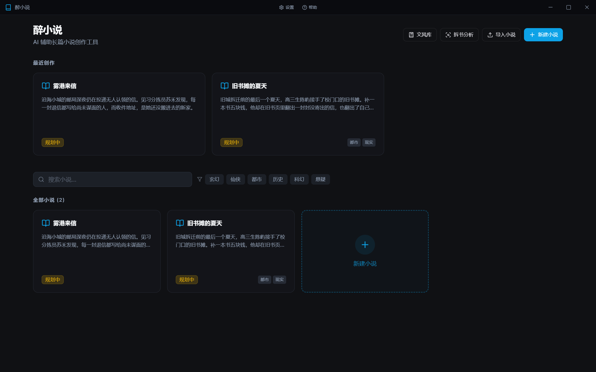
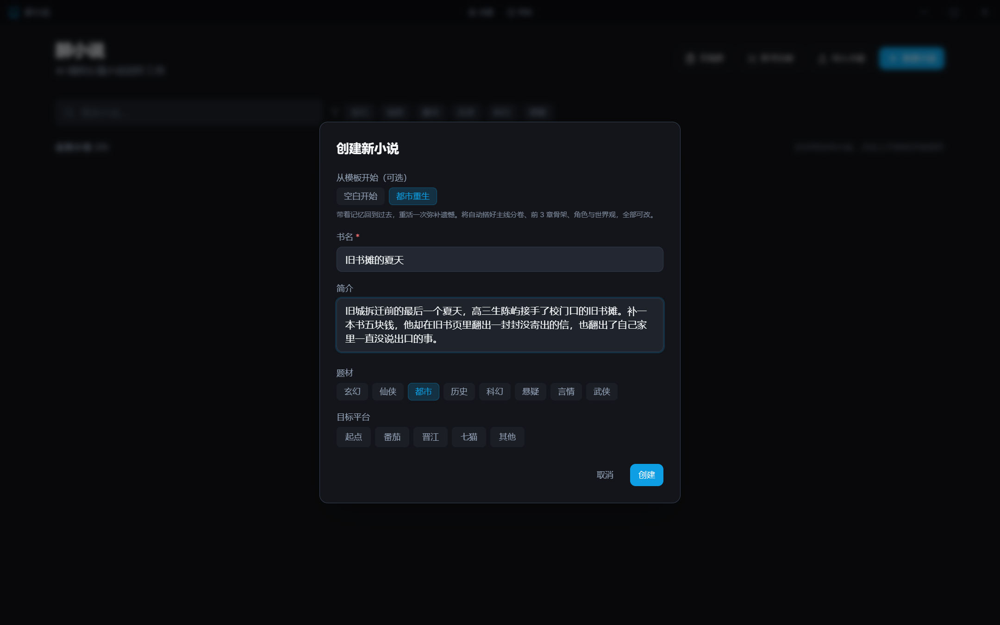
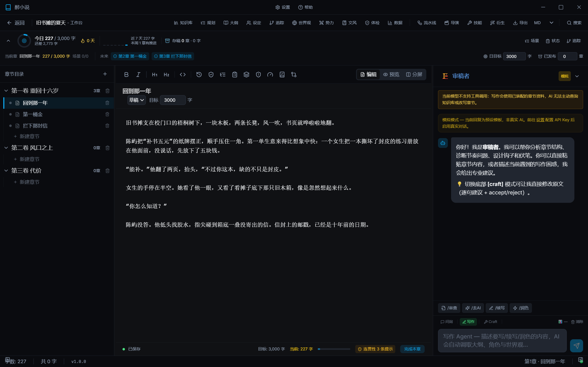
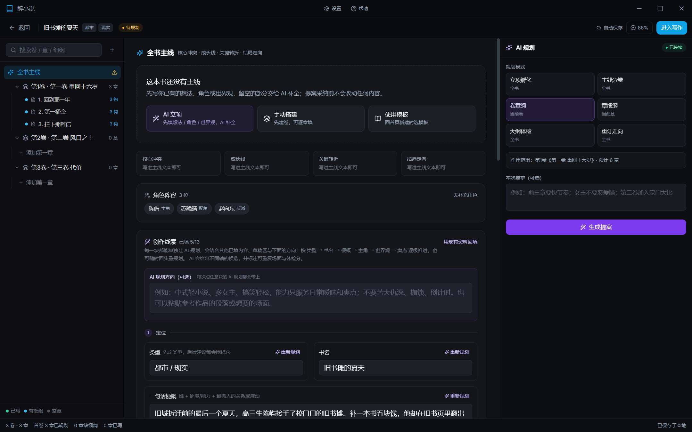
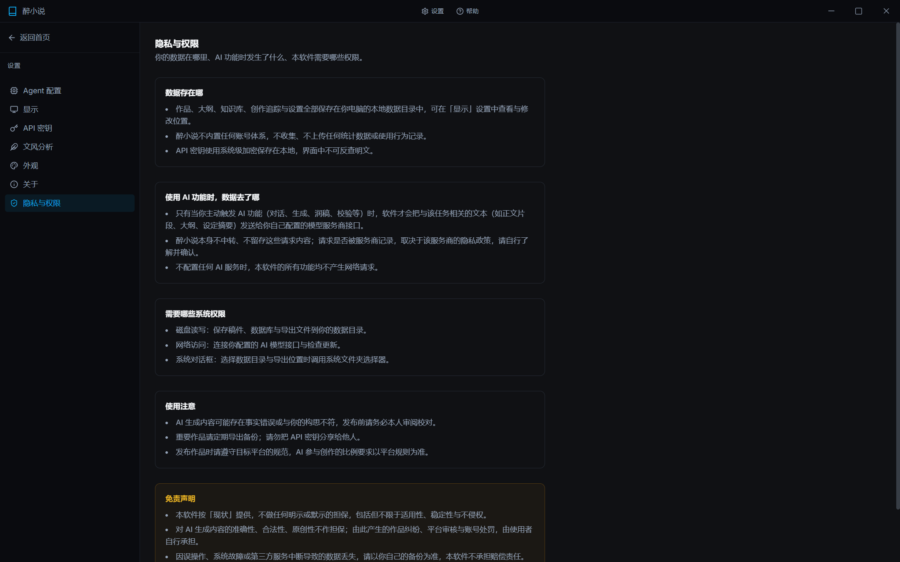
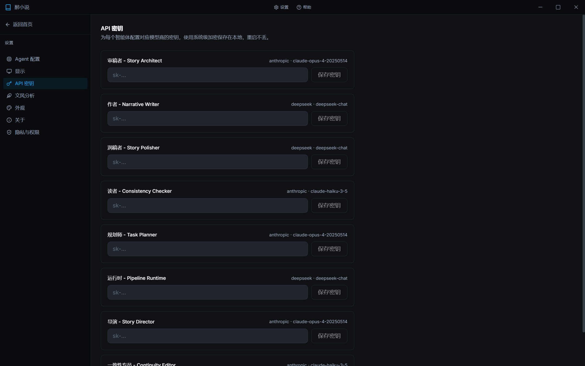
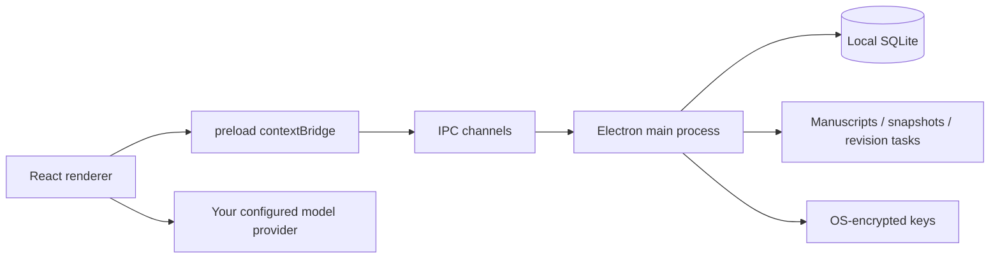

<div align="center">



<h1>ZuiXiaoShuo · 醉小说</h1>

<p><strong>A local-first AI studio for long-form fiction</strong></p>

<p>
  
  <a href="LICENSE"></a>
  
  
  
</p>

<p>
  <a href="README.md">简体中文</a> ·
  <a href="https://github.com/zuili1204/ZuiXiaoShuo/releases/latest">Download</a> ·
  <a href="#getting-started">Getting started</a> ·
  <a href="LICENSE">License</a>
</p>

</div>

> [!IMPORTANT]
> This project uses a **custom non-commercial license**: learning, research, teaching and secondary development are allowed, while **all commercial use is prohibited**. See [LICENSE](LICENSE).

ZuiXiaoShuo brings the full loop of **ideation → planning → daily writing → quality checks → revision → export** into one desktop app. Manuscripts, story settings, the knowledge base and API keys stay on your machine. There is no account system and no telemetry.

## Contents

- [Why ZuiXiaoShuo](#why-zuixiaoshuo)
- [Features](#features)
- [Screenshots](#screenshots)
- [Architecture](#architecture)
- [Download and run](#download-and-run)
- [Getting started](#getting-started)
- [AI setup and API keys](#ai-setup-and-api-keys)
- [Data location and backups](#data-location-and-backups)
- [Testing and building](#testing-and-building)
- [Project structure](#project-structure)
- [FAQ](#faq)
- [Contributing](#contributing)
- [License](#license)
- [Disclaimer](#disclaimer)

## Why ZuiXiaoShuo

- **Built for long books**: not a one-shot generator, but a workspace that keeps continuity across hundreds of thousands of words with a knowledge base, chapter summaries, character state, timeline and foreshadowing tracking.
- **Local first**: manuscripts and keys stay on your machine. AI goes online only when you trigger it, and you choose which provider receives the text.
- **AI you can steer**: planning is generated and filled block by block; prose advances scene by scene; the pipeline is blocked when the quality gate fails.
- **A complete writing loop**: book planning, a daily-writing cockpit, chapter review, reader simulation, revision cascade, snapshot rollback and DOCX export in one workbench.
- **Tuned for Chinese web novels**: 30+ built-in writing skills covering ideation, characters, worldview, outlines, openings, continuation, de-AI polishing, continuity and revision.

## Features

| Area | Capabilities |
| --- | --- |
| Ideation and planning | Genre templates, block-by-block AI proposals, outline wizard, plan health checks, arc recalibration |
| Writing and daily updates | Chapter tree, manuscript editor, scene cards, state cards, daily cockpit, context token budget |
| Story memory | Knowledge base, chapter summaries, character profiles, timeline, plot threads, foreshadowing |
| Continuity | Deterministic checks for dead characters, early items/abilities, time reversal, plus soft warnings |
| Style learning | Multi-source corpus import, nine-dimension profile, style anchors, blended recipes, post-generation deviation |
| Quality and review | Unified quality gate, AI-rate detection, three-layer chapter review, reader simulation, author feedback |
| Revision and versioning | Chapter snapshots, line-level diff, per-block adoption, revision cascade, task closure |
| Import and output | txt/md import, book deconstruction, DOCX export, platform data, release scheduling, series management |

### Ideation and planning

- **Genre templates**: scaffold the first volume, a three-chapter opening, character cards and worldview entries in one click — everything remains editable.
- **Block-by-block planning**: titles, premise, protagonist, cast, worldview, special abilities and selling points are generated separately, with per-block regeneration or full manual entry.
- **Outline wizard**: build volumes and the first three chapter outlines in a slide-over panel, then re-steer later arcs whenever needed.
- **Plan health checks**: detect structural issues in the main line, cast and chapter hooks before drafting, with evidence-backed suggestions.

### Writing and daily updates

- **Workbench**: chapter tree, editor, scene cards, state cards and an AI sidebar on one screen, with autosave.
- **Scene-card driven drafting**: split outlines into scene cards, generate or rewrite them one by one, and mark progress inside the manuscript.
- **Daily cockpit**: today's word count, target progress, streak and shortcuts to upcoming chapters.
- **Context budget**: assemble outlines, characters, worldview, recaps and style hints within a token budget, with a preview of exactly what will be sent.
- **Writing tools**: the AI can read the novel profile, outline, characters, worldview, factions, tracking state and chapter context, then write chapters back, commit tracking changes and search the knowledge base.

### Story memory and continuity

- **Knowledge base**: per-book chapter summaries, character profiles, settings and foreshadowing, with search and auto-build.
- **Story State**: append-only tables for character state, timeline and plot threads — who changed, when and where.
- **Deterministic continuity checks**: hard rules such as a dead character appearing, an item or ability being used too early, or time flowing backwards, plus a set of softer warnings wired into save hints and pipeline gates.

### Style learning

- **Style library**: import a single file, a chapter directory or pasted text, with chapter-split preview.
- **Profiles and recipes**: sample-analyze a nine-dimension profile with rules and style anchors; merge multiple sources with global or per-dimension weights and bind the recipe to a book.
- **Post-generation evaluation**: quantify deviation, dimension adherence, 12-character n-grams, longest common substrings and proper-noun leakage, with history.

### Quality, review and revision

- **Quality gate**: deterministic checks first, heuristics as fallback; the pipeline is blocked when the manuscript does not pass.
- **AI-rate detection**: manually triggered, showing an AI-flavor score and itemized findings (line, severity, excerpt), with one-click handoff to de-AI polishing.
- **Chapter review**: three-layer checks plus reader simulation covering hook strength, information density, emotional curve, drop-off points and actionable advice.
- **Author feedback**: accept, reject or annotate review results, stored per chapter.
- **Snapshots and diff**: automatic/manual snapshots, version preview, line-level diff, per-block adopt or revert, with an automatic backup before applying.
- **Revision cascade**: detect characters or items in a change, find matching sentences in later chapters, and manage revision tasks to closure.

### Import, deconstruction and operations

- **Novel import**: txt/md with automatic chapter splitting and knowledge-base creation.
- **Book deconstruction**: sample a reference book chapter by chapter to produce a report and reusable trope templates.
- **Platform data**: import daily / chapter / comment CSVs locally or enter data manually; inspect trends, completion-rate anomalies and comment sentiment, with de-identified binned CSV export.
- **Release scheduling**: schedule by start date and chapters per day, mark published chapters and copy text; it never connects to a platform or auto-publishes.
- **DOCX export**: volume/chapter heading structure, for the whole book or a selected range.
- **Series management**: group books by series name and order, with aggregate word counts.

## Screenshots

| Create from template | Writing workbench |
| :---: | :---: |
|  |  |

| Book planning | Privacy and permissions |
| :---: | :---: |
|  |  |

| API keys (OS-level encryption) | Home library |
| :---: | :---: |
|  |  |

> Screenshots use fictional titles and prose, with no real manuscript content.

## Architecture



| Layer | Choice |
| --- | --- |
| Desktop shell | Electron 33 |
| UI | React 19 · TypeScript · Vite 5 · Tailwind CSS · Zustand · TanStack Query |
| Local storage | better-sqlite3 (~30 tables) · filesystem |
| Main process | Windows and IPC (30+ channels) · atomic writes · key encryption · action log |
| Skill system | 30+ writing skills driven by `SKILL.md`, assembled into prompts on demand |
| Testing | Vitest (unit/service) · Playwright Electron E2E |

Call chain: renderer → `preload` contextBridge → IPC → main-process services → SQLite/filesystem. AI requests go directly from renderer services to the provider you configured; the main process neither relays nor stores request bodies.

## Download and run

No development environment needed: download the Windows build from [Releases](https://github.com/zuili1204/ZuiXiaoShuo/releases/latest) and run it directly.

- **Installer** (`ZuiXiaoShuo-1.0.0-Setup.exe`): double-click to install, choose the install directory and create desktop / Start menu shortcuts.
- **Portable** (`ZuiXiaoShuo-1.0.0-portable.exe`): no installation, just run the downloaded executable.

No account is required. Without a model API key, scoping, planning, editing, snapshots, local quality checks and DOCX export all still work. Windows 10 / 11 (x64) is required.

## Getting started

### Requirements

- Node.js 20 or newer
- Windows 10 / 11 (the primary supported platform)
- A toolchain able to compile the native `better-sqlite3` module on first install

> All 30+ built-in writing skills (`src/skills/`) are published with this repository and can be read, modified and extended directly.

### Install and run

```bash
# Install dependencies
npm install

# Development: Vite dev server + Electron
npm run electron:dev

# Production build and local run
npm run build
npm run electron:preview
```

### Package an installer

```bash
npm run electron:build
```

On Windows this produces NSIS and portable builds under `release/` (git-ignored).

## AI setup and API keys

AI features use your own model-provider keys. There is no built-in account.

1. Open **Settings → API keys**.
2. Enter a key for each agent (reviewer, author, polisher, reader, planner, runtime, director, and so on).
3. Click **Save key**. Keys are encrypted with OS-level facilities and stored locally; the UI never reveals them in plaintext.

You can also change providers and models per agent. Without any key, planning, manuscript editing, snapshots, local quality checks and DOCX export still work; the AI panel shows a simulation-mode notice.

> [!WARNING]
> Never put keys in source files, `.env` files or commits. If you previously committed a key in an old branch or version, revoke it with your provider and generate a new one.

## Data location and backups

- The database and configuration live in Electron's `userData` directory (on Windows typically `%APPDATA%\zuixiaoshuo`).
- Manuscripts, snapshots and revision tasks live under `content/` in the data directory. You can inspect or change the data directory in **Settings → Display**.
- The database is a single SQLite file, and the UI shows its current location.
- Export your books or back up the whole data directory before uninstalling or switching machines.

<details>
<summary><b>Isolate real data for tests / screenshots</b></summary>

```bash
# Point userData at a temporary directory; your real books are never read
ZXS_USER_DATA_DIR=/tmp/zxs-demo npm run electron:preview
```

Windows PowerShell:

```powershell
$env:ZXS_USER_DATA_DIR="$env:TEMP\zxs-demo"; npm run electron:preview
```

</details>

## Testing and building

| Command | Description |
| --- | --- |
| `npm run typecheck` | Type-check both tsconfigs |
| `npm test` | Vitest unit and service tests |
| `npm run eval:plan` | Planning evaluation baseline |
| `npm run e2e` | Playwright Electron acceptance tests |
| `npm run build` | Type-check + renderer and main-process build |
| `npm run electron:build` | Package the Windows installer |

E2E runs use an isolated temporary `userData` directory and never touch real books.

## Project structure

```text
electron/            Main process: window, IPC, SQLite, file and key services
  main.ts            App entry and IPC registration
  preload.ts         contextBridge security bridge
  services/          Database, file, key, logging, quality and plan validation
src/                 Renderer
  pages/             Home, workbench, planning, style library, settings, help
  components/        Editor, outline, knowledge base, style, settings UI
  services/          AI calls, context assembly, planning, continuity, export, etc.
  skills/            30+ SKILL.md writing skills and references (open source with this repo)
  stores/            Zustand state
shared/              Types and pure algorithms shared by main and renderer
scripts/             Metrics, planning evaluation, baseline tooling
e2e/                 Playwright Electron acceptance tests
assets/screenshots/  README screenshots (fictional sample data)
```

## FAQ

<details>
<summary><b>Can I use it without an API key?</b></summary>

Yes. Planning, editing, snapshots, local quality checks, book deconstruction and DOCX export do not require a model. AI generation, polishing and reader simulation need a key.

</details>

<details>
<summary><b>Will my novel be uploaded?</b></summary>

Not automatically. Only when you explicitly trigger an AI feature is the relevant task text sent to your configured provider. The app has no account system and collects no telemetry.

</details>

<details>
<summary><b>Does it run on macOS / Linux?</b></summary>

Windows 10/11 is the primary supported platform; other platforms are not fully verified. The Electron and frontend code is cross-platform, and builds/feedback are welcome.

</details>

<details>
<summary><b>Can I use it commercially?</b></summary>

No. The project uses a non-commercial license: learning, research, teaching and secondary development are allowed, but commercial use is prohibited. Contact the maintainer for a commercial license.

</details>

## Contributing

- Open an issue with the problem, reproduction steps and expected behavior.
- Run `npm run typecheck` and `npm test` before submitting a PR.
- Never commit real manuscripts, API keys, databases or log files.
- Contributions are licensed under the project's non-commercial license.

## License

This project is released under the [ZuiXiaoShuo Non-Commercial License 1.0](LICENSE):

- personal learning, research, teaching, evaluation and non-profit secondary development are allowed;
- modified versions may be distributed under the same license;
- **all commercial use is prohibited**;
- the software is source-available, not OSI-approved open source.

## Disclaimer

This software is provided "as is", without warranty of the accuracy, legality or originality of AI-generated content. Any resulting disputes, platform review outcomes or account penalties are the user's responsibility. Follow the rules of your target platform and back up important work regularly.
