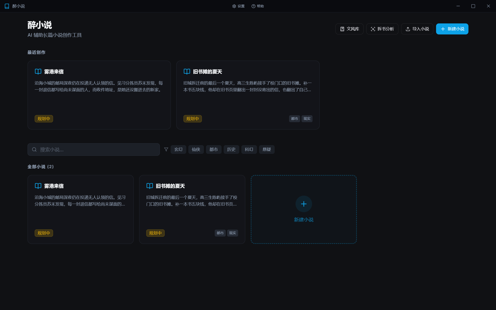
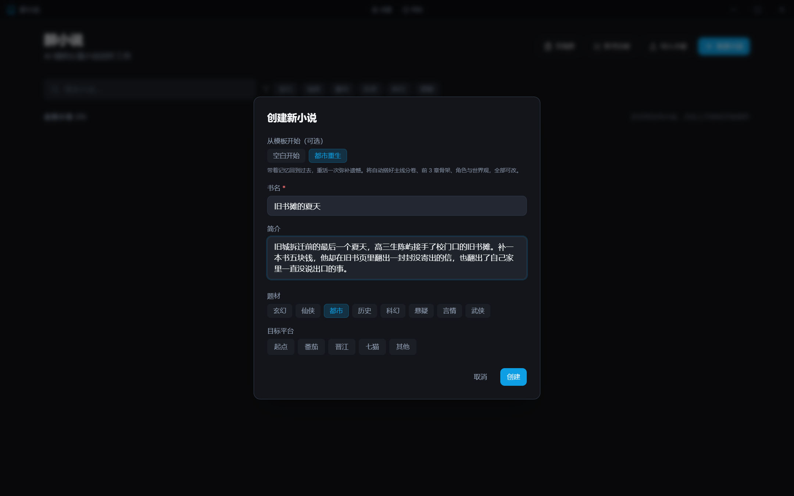
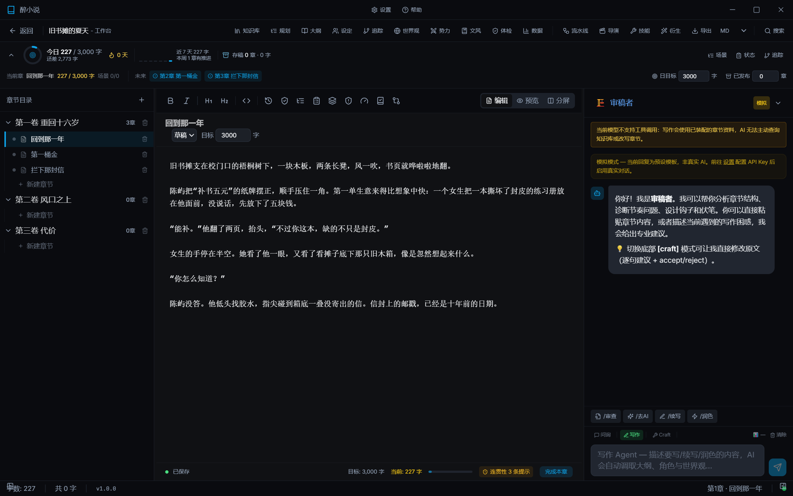
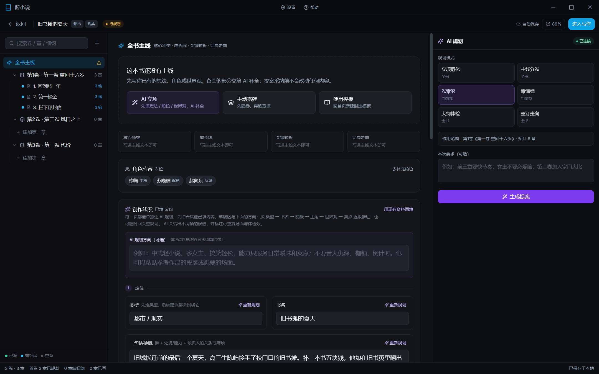
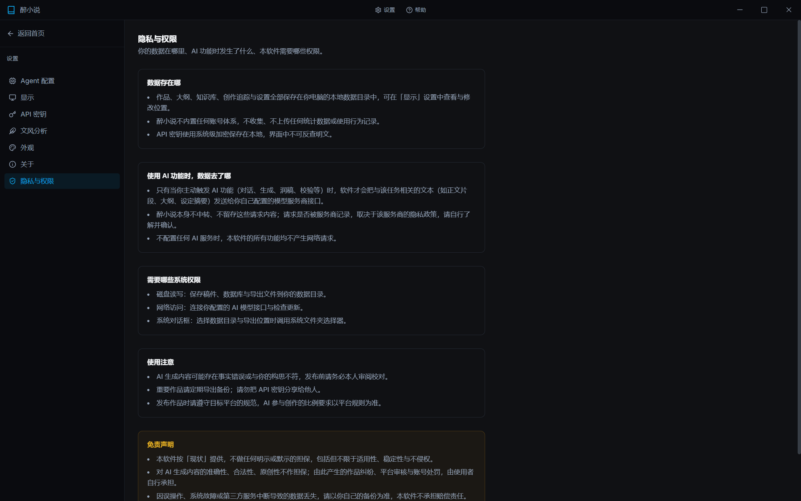
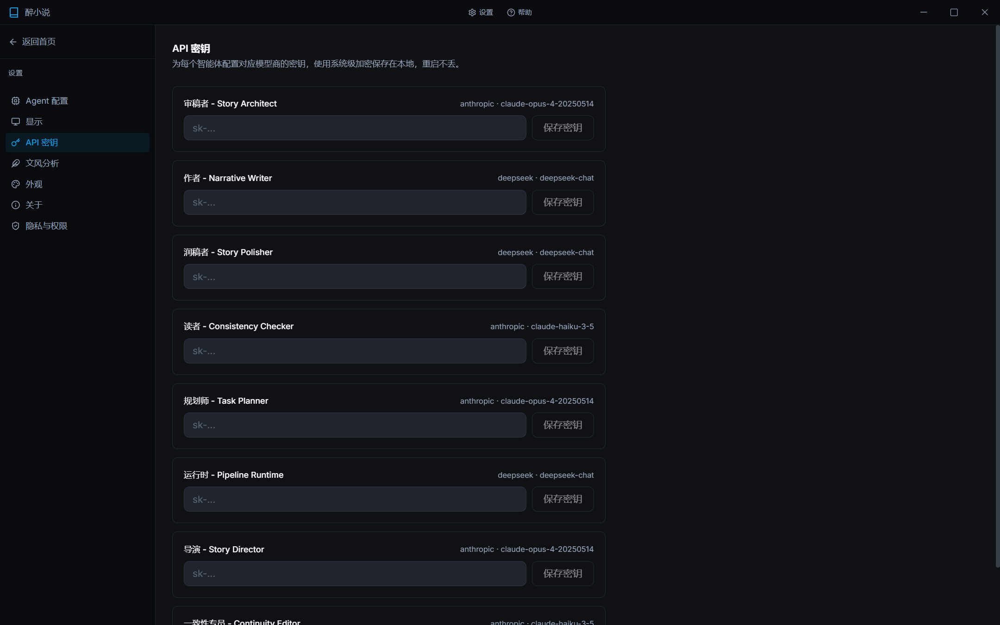
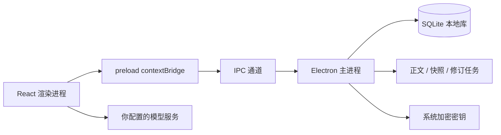

<div align="center">



<h1>醉小说 · ZuiXiaoShuo</h1>

<p><strong>本地优先的 AI 长篇小说创作工具</strong></p>

<p>
  
  <a href="LICENSE"></a>
  
  
  
</p>

<p>
  <a href="README.en.md">English</a> ·
  <a href="#快速开始">快速开始</a> ·
  <a href="LICENSE">许可证</a>
</p>

</div>

> [!IMPORTANT]
> 本项目采用**自定义非商业许可证**：允许学习、研究、教学与二次开发，**禁止任何形式的商业使用**。详见 [LICENSE](LICENSE)。

醉小说把「立项 → 规划 → 日更 → 质检 → 改稿 → 导出」放进一个桌面应用里。稿件、设定、知识库与 API 密钥全部保存在本机，不设账号体系，不上传统计数据。

## 目录

- [为什么是醉小说](#为什么是醉小说)
- [功能概览](#功能概览)
- [界面预览](#界面预览)
- [技术架构](#技术架构)
- [快速开始](#快速开始)
- [配置 AI 与 API 密钥](#配置-ai-与-api-密钥)
- [数据存放与备份](#数据存放与备份)
- [测试与构建](#测试与构建)
- [项目结构](#项目结构)
- [常见问题](#常见问题)
- [参与贡献](#参与贡献)
- [许可证](#许可证)
- [免责声明](#免责声明)

## 为什么是醉小说

- **为长书设计**：不是单次生成器，而是用知识库、章节摘要、角色状态、时间线与伏笔追踪维持几十万字的连续性。
- **本地优先**：作品与密钥留在本机；AI 只在你主动触发时联网，发给哪家服务商由你决定。
- **可干预的 AI**：规划逐块生成、逐块回填；正文逐场景推进；质量门禁不通过就拦截下发。
- **完整的写作闭环**：开书规划、日更驾驶舱、章节评估、读者模拟、改稿级联、快照回滚与 DOCX 导出都在同一个工作台。
- **中文网文工作流**：内置 30+ 个写作技能，覆盖立项、人物、世界观、大纲、开篇、续写、去 AI 味、一致性与修订。

## 功能概览

| 模块 | 能力 |
| --- | --- |
| 立项与规划 | 题材模板、AI 逐块提案、大纲向导、规划体检、后续走向重校准 |
| 写作与日更 | 章节树、正文编辑、场景卡、状态卡、日更驾驶舱、上下文 token 预算 |
| 故事记忆 | 知识库、章节摘要、角色档案、时间线、剧情线、伏笔追踪 |
| 一致性 | 死者出场、物品/能力提前、时间倒流等确定性检查 + 软提示 |
| 文风学习 | 多源语料导入、九维画像、风格锚点、多书融合配方、生成后偏离评估 |
| 质量与评估 | 统一质量门禁、AI 率检测、三层章节评估、读者模拟、作者反馈 |
| 改稿与版本 | 章节快照、行级 diff、逐段采用、改稿级联、修订任务闭环 |
| 导入与产出 | txt/md 导入、拆书分析、DOCX 导出、平台数据、存稿排期、系列管理 |

### 立项与开书

- **题材模板**：一键生成首卷分卷、黄金三章骨架、角色卡与世界观条目，全部可改。
- **逐块规划**：书名、梗概、主角、角色、世界观、金手指、卖点分别生成，可回填重规划，也可完全手填。
- **大纲向导**：用滑出面板完成分卷与前三章细纲，后续走向可随时重订。
- **规划体检**：开写前检查主线、角色与章节钩子，给出带证据的修订建议。

### 写作与日更

- **工作台**：章节树、编辑器、场景卡、状态卡与 AI 侧栏同屏协作，自动保存。
- **场景卡驱动**：把细纲拆成场景卡，逐卡生成、重写并在正文中标记完成度。
- **日更驾驶舱**：今日字数、目标进度、连续更新与未来章节入口集中展示。
- **上下文预算**：按 token 预算装配大纲、角色、世界观、前文摘要与文风提示，可预览实际下发内容。
- **写作工具**：AI 可读取作品档案、大纲、角色、世界观、势力、追踪状态与章节上下文，并回写章节、提交追踪变更、检索知识库。

### 故事记忆与一致性

- **知识库**：按书维护章节摘要、角色档案、设定与伏笔，支持检索与自动补建。
- **Story State**：角色状态、时间线、剧情线三张只追加表，记录谁在何时何地变成了什么样。
- **确定性连贯性检查**：死者出场、物品提前、能力提前、时间倒流等硬伤规则，配合多类软提示，接入保存提示与流水线门禁。

### 文风学习

- **文风库**：支持单文件、章节目录、粘贴三种语料导入与切章预览。
- **画像与配方**：抽样分析生成九维画像、规则与风格锚点；多书按全局或分维度权重融合并绑定到作品。
- **生成后评估**：量化偏离、维度贴合度、12 字 n-gram、最长公共子串与专有名词泄漏告警，历史可追溯。

### 质量、评估与改稿

- **质量门禁**：确定性脚本优先、启发式降级；正文未通过门禁时拦截流水线下发。
- **AI 率检测**：手动触发，展示 AI 味指数与逐条问题（行号、严重度、摘录），可一键转入去 AI 味流程。
- **章节评估**：三层检查与读者模拟，输出钩子强度、信息密度、情绪曲线、弃读点与可执行建议。
- **作者反馈**：接受、拒绝或批注评估结果，按章留存。
- **快照与 diff**：自动/手动快照、版本预览、行级 diff、逐段采用或撤回，应用前自动留底。
- **改稿级联**：从改动中识别角色或物品，检查后续章节命中句，生成修订任务并支持闭环。

### 导入、拆书与运营辅助

- **导入小说**：支持 txt/md，自动切章并建立知识库。
- **拆书分析**：逐章采样参考书，产出拆书报告与可复用套路模板。
- **平台数据**：本地导入每日/章节/评论 CSV 或手动录入，查看趋势、完读率异常与评论情绪；可导出为脱敏分桶 CSV。
- **存稿排期**：按起始日与每日章数排期，标记已发布、复制正文；不会连接平台或自动发布。
- **DOCX 导出**：按卷/章层级排版，支持全书或指定章节范围。
- **系列管理**：设置系列名与序号，汇总系列书目与字数。

## 界面预览

| 从模板创建 | 写作工作台 |
| :---: | :---: |
|  |  |

| 开书规划 | 隐私与权限 |
| :---: | :---: |
|  |  |

| API 密钥（系统级加密） | 首页书库 |
| :---: | :---: |
|  |  |

> 截图使用虚构书目与正文，不包含任何真实作品内容。

## 技术架构



| 层 | 选型 |
| --- | --- |
| 桌面容器 | Electron 33 |
| 界面 | React 19 · TypeScript · Vite 5 · Tailwind CSS · Zustand · TanStack Query |
| 本地存储 | better-sqlite3（约 30 张表）· 文件系统 |
| 主进程 | 窗口与 IPC（30+ 通道）· 原子文件写入 · 密钥加密 · 操作日志 |
| 技能系统 | `SKILL.md` 驱动的 30+ 个写作技能，按需装配提示词 |
| 测试 | Vitest（单元/服务）· Playwright Electron E2E |

调用链：渲染进程 → `preload` contextBridge → IPC → 主进程服务 → SQLite/文件系统。AI 请求由渲染进程业务服务直接发往你配置的模型服务商，主进程不中转、不保存请求正文。

## 快速开始

### 环境要求

- Node.js 20 或更高版本
- Windows 10 / 11（当前主要支持平台）
- 首次安装需要能编译原生模块 `better-sqlite3`

> [!IMPORTANT]
> 写作技能库（`src/skills/`）不随公开仓库发布。本地运行或构建前需自备技能库，并配置加密密钥（环境变量 `ZXS_SKILL_KEY`，或写入已被忽略的 `.env.skills.local`）。缺少技能库或密钥时，类型检查与构建无法完成；技能库、密钥文件和加密产物均不会进入 Git。

### 安装与运行

```bash
# 安装依赖
npm install

# 开发模式：Vite 开发服务器 + Electron
npm run electron:dev

# 生产构建并本地运行
npm run build
npm run electron:preview
```

### 打包安装程序

```bash
npm run electron:build
```

Windows 下会生成 NSIS 安装包与 portable 版本，输出目录为 `release/`（已加入 `.gitignore`）。

## 配置 AI 与 API 密钥

AI 功能使用你自己的模型服务密钥，不使用内置账号。

1. 打开 **设置 → API 密钥**。
2. 为「审稿者 / 作者 / 润色师 / 读者 / 规划师 / 运行时 / 导演」等智能体填入对应服务商的密钥。
3. 点击「保存密钥」。密钥使用系统级加密保存在本地，界面中不可反查明文。

你也可以在各智能体配置里切换服务商与模型。未配置任何密钥时，立项、规划、正文编辑、快照、本地质检与 DOCX 导出等不依赖模型的流程仍可正常使用；AI 面板会显示模拟模式提示。

> [!WARNING]
> 请勿把密钥写入源码、`.env` 或提交到仓库。若你曾在旧版本或分支中提交过密钥，请立即到服务商后台吊销并重新生成。

## 数据存放与备份

- 数据库与配置保存在 Electron 的 `userData` 目录（Windows 默认 `%APPDATA%\zuixiaoshuo`）。
- 正文、快照、修订任务等文件保存在数据目录下的 `content/`，可在 **设置 → 显示** 查看与修改数据目录。
- 数据库为单个 SQLite 文件，界面会明确显示当前位置。
- 卸载或更换电脑前，请导出作品或备份整个数据目录。

<details>
<summary><b>用临时目录隔离真实数据（测试 / 截图）</b></summary>

```bash
# 将 userData 指向临时目录，真实书稿不会被读取
ZXS_USER_DATA_DIR=/tmp/zxs-demo npm run electron:preview
```

Windows PowerShell：

```powershell
$env:ZXS_USER_DATA_DIR="$env:TEMP\zxs-demo"; npm run electron:preview
```

</details>

## 测试与构建

| 命令 | 说明 |
| --- | --- |
| `npm run typecheck` | 双 tsconfig 类型检查 |
| `npm test` | Vitest 单元与服务测试 |
| `npm run eval:plan` | 规划评估基线 |
| `npm run e2e` | Playwright Electron 验收测试 |
| `npm run build` | 类型检查 + 渲染层与主进程构建 |
| `npm run electron:build` | 打包 Windows 安装程序 |

E2E 默认使用独立的临时 `userData`，不会读写真实作品。

## 项目结构

```text
electron/            主进程：窗口、IPC、SQLite、文件与密钥服务
  main.ts            应用入口与 IPC 注册
  preload.ts         contextBridge 安全桥
  services/          数据库、文件、密钥、日志、质量与规划校验
src/                 渲染进程
  pages/             首页、工作台、规划、文风库、设置、帮助
  components/        编辑器、大纲、知识库、文风、设置等 UI
  services/          AI 调用、上下文装配、规划、连贯性、导出等业务逻辑
  skills/            写作技能库（仅本地保留，不入库；缺失时无法构建）
  stores/            Zustand 状态
shared/              主渲染共享的类型与纯算法（文风指标、工艺规则）
scripts/             指标计算、规划评估、基线工具
e2e/                 Playwright Electron 验收测试
assets/screenshots/  README 截图（虚构示例数据）
```

## 常见问题

<details>
<summary><b>没有 API Key 可以使用吗？</b></summary>

可以。立项、规划、编辑、快照、本地质检、拆书与 DOCX 导出等功能不依赖模型；AI 生成、润色与读者模拟需要你配置密钥。

</details>

<details>
<summary><b>我的小说会被上传吗？</b></summary>

不会自动上传。只有你主动触发 AI 功能时，相关任务文本才会发送给你配置的模型服务商。软件不设账号体系，不收集统计数据。

</details>

<details>
<summary><b>支持 macOS / Linux 吗？</b></summary>

当前以 Windows 10/11 为主要支持平台，其他平台尚未完整验证。Electron 与前端代码本身跨平台，欢迎自行构建与反馈。

</details>

<details>
<summary><b>可以商用吗？</b></summary>

不可以。本项目采用非商业许可证，允许学习、研究、教学与二次开发，禁止商业使用。商业授权请联系维护者。

</details>

## 参与贡献

- 欢迎提交 Issue 描述问题、复现步骤与预期行为。
- 提交 PR 前请运行 `npm run typecheck` 与 `npm test`。
- 请勿提交真实书稿、API 密钥、数据库或日志文件。
- 贡献内容默认沿用本项目的非商业许可证。

## 许可证

本项目采用 [醉小说非商业许可证 1.0](LICENSE)：

- 允许个人学习、研究、教学、评估与非营利二次开发；
- 允许在相同许可证下分发修改版本；
- **禁止任何形式的商业使用**；
- 本软件为 source-available，不是 OSI 认可的开源软件。

## 免责声明

本软件按「现状」提供，不对 AI 生成内容的准确性、合法性、原创性作担保。由此产生的作品纠纷、平台审核与账号处罚，由使用者自行承担。请遵守目标平台的规则，并定期备份重要作品。
